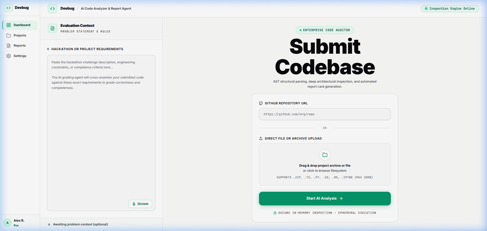
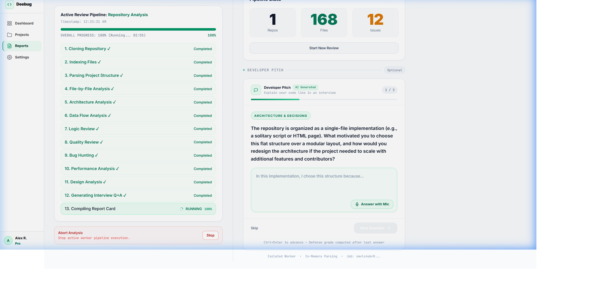
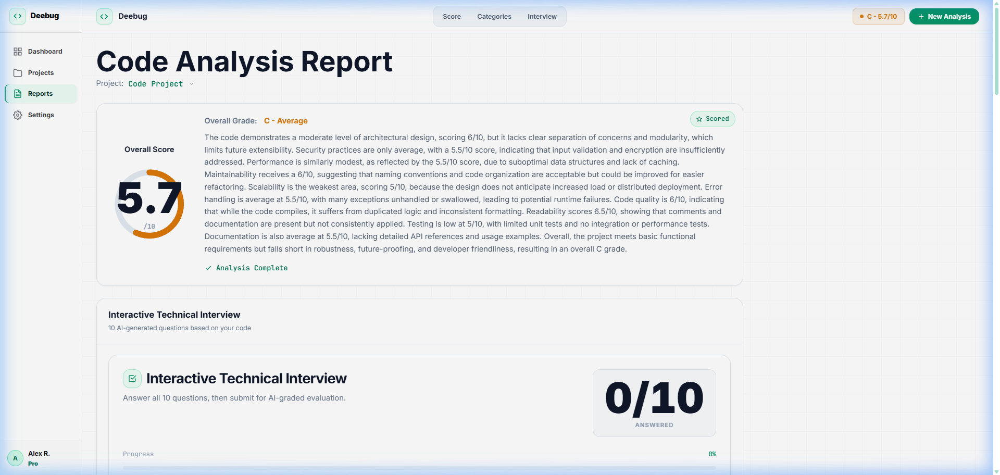
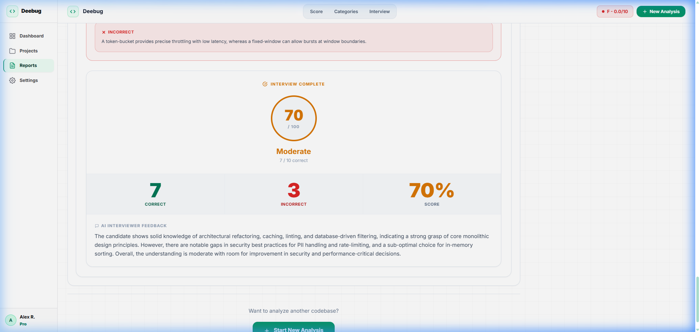
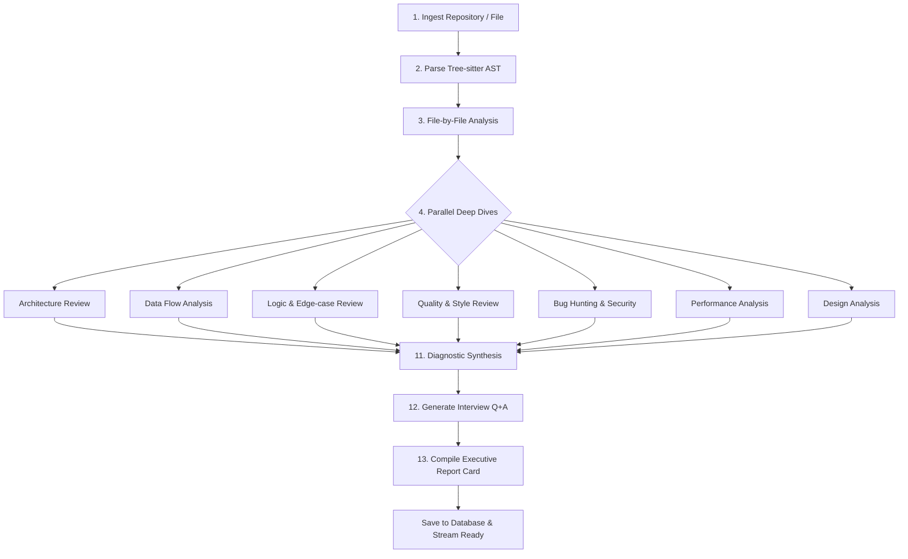

<div align="center">


# Deebug — AI Code Analyzer & Report Card Agent

**An autonomous, full-stack AI engineering platform that performs multi-phase static and LLM analysis on codebases, delivers strict numeric report cards, and challenges developers with interactive technical interviews.**

[](https://www.typescriptlang.org/)
[](https://nextjs.org/)
[](https://github.com/langchain-ai/langgraphjs)
[](https://turbo.build/)
[](LICENSE)

<br/>

> **Submit any codebase** — via GitHub repository URL, uploaded ZIP file, or direct code paste — and receive an evidence-backed Report Card with category grades (0–10), AST complexity metrics, detected bugs, and an interactive technical interview to defend your design choices.

<br/>

[Quick Start](#-quick-start) • [Live Screenshots](#-live-screenshots) • [Architecture](#-architecture) • [Analysis Pipeline](#-13-phase-analysis-pipeline) • [Evaluation & Scoring](#-scoring-rubric--weights) • [Tech Stack](#-tech-stack)

</div>

---

## ⚡ Highlights & Real Features

| Feature | Description |
|---|---|
| **Multi-Source Code Ingestion** | Ingest public GitHub repositories, multi-file `.zip` archives, or quick-paste code snippets into memory. |
| **AST-Level Static Analysis** | Tree-sitter static analysis extracts functions, classes, cyclomatic complexity, and dependency graphs *before* any LLM call. |
| **Multi-Stage LLM Evaluation** | LangGraph pipeline orchestrates parallel reviewers covering Architecture, Security, Performance, Data Flow, Logic, and Code Quality. |
| **Multi-Provider LLM Failover** | Auto-rotates between primary high-capacity models (Groq `openai/gpt-oss-120b`), fast fallbacks (`openai/gpt-oss-20b`, `qwen/qwen3.8-27b`), and OpenRouter/Google Gemini endpoints. |
| **Real-Time Live Tracker** | Server-Sent Events (SSE) stream phase-by-phase execution progress (1–13 phases) with automated completion handling. |
| **Parallel Developer Pitch** | While code is analyzed, custom architectural and trade-off defense questions are formulated in real-time. Includes **Speech-to-Text Microphone** voice recording and composite grading (Code Audit 65% + Defense 35%). |
| **Interactive Technical Interview** | 10 codebase-tailored MCQs generated directly from your code, evaluated with instant AI scoring (0–100), per-question correctness, and qualitative feedback. |
| **Strict Numeric Grading** | A/B/C/D/F grades with weighted 10-category scoring (0.0 to 10.0), detailed score deduction reasoning, and drilldown findings. |

---

## 📸 Live Screenshots

### 1. Dashboard & Analysis Launcher
Submit repositories, upload archive packages, or paste code directly into the review workspace.


### 2. Live Progress Tracker & Parallel Developer Pitch
Real-time SSE progress streaming through all 13 analysis phases, paired with real-time architectural defense questions and speech-to-text mic input.


### 3. Executive Code Analysis Report Card
Comprehensive 10-category breakdown with overall numeric score ring, letter grade, and architectural evaluation.


### 4. Interactive Technical Interview Results
Automated grading of candidate answers with overall score (0–100), correct/incorrect metrics, and qualitative evaluator feedback.


---

## 🏗️ Architecture

```
+-----------------------------------------------------------------+
|                        Deebug Platform                          |
+-----------------------------------------------------------------+
|   Input Sources  |   GitHub URL  |  ZIP Upload  |  Code Editor  |
+-----------------------------------------------------------------+
                                |
                                v
+-----------------------------------------------------------------+
|            @code-analyzer/web  (Next.js 14 Frontend)            |
|   Tailwind CSS  |  SSE Progress  |  Microphone STT | Dashboard  |
+-----------------------------------------------------------------+
                                | Database Polling / BullMQ
                                v
+-----------------------------------------------------------------+
|          @code-analyzer/worker  (Node.js Background)            |
|             Isolated background job execution runner            |
+-----------------------------------------------------------------+
                                |
                                v
+-----------------------------------------------------------------+
|         @code-analyzer/pipeline  (LangGraph Pipeline)           |
|                                                                 |
|   [Tree-sitter AST] -> [File Analysis] -> [Parallel Reviews]   |
|                                                  |              |
|                              +-------------------+              |
|                         Architecture    Security                |
|                         Performance     Data Flow               |
|                         Logic           Quality                 |
|                              +-------------------+              |
|                                                  |              |
|                                                  v              |
|                [Diagnostic Synthesis] -> [Report Card] -> [DB]  |
+-----------------------------------------------------------------+
                                |
                                v
+-----------------------------------------------------------------+
|             @code-analyzer/db  (Prisma ORM + SQLite)            |
+-----------------------------------------------------------------+
```

---

## 🔄 13-Phase Analysis Pipeline

Every code submission flows through a LangGraph directed state machine:



| Phase | Description |
|---|---|
| **1. Ingest** | Clones the GitHub repo, extracts the `.zip` archive, or writes snippet to isolated disk sandbox. |
| **2. Parse AST** | Tree-sitter parses TypeScript, JavaScript, Python, Go, and Java into structured syntax trees. |
| **3. File Analysis** | Calculates file responsibilities, public APIs, and complexity metrics. |
| **4–10. Deep Dives** | Parallel LLM reviewer nodes assess architecture, data flow, logic, quality, bugs, performance, and design. |
| **11. Diagnostics** | Synthesizes top critical findings and generates evidence anchors. |
| **12. Interview Q+A** | Formulates 10 targeted multiple-choice technical interview questions based on the candidate's code. |
| **13. Report Card** | Calculates weighted category scores, assigns final letter grade, and stores the completed report in SQLite. |

---

## 📊 Scoring Rubric & Weights

Each project is evaluated across 10 distinct software engineering dimensions:

| Category | Weight | Evaluates |
|---|---|---|
| **Architecture** | **15%** | Separation of concerns, module boundaries, architectural patterns |
| **Security** | **15%** | Input validation, sanitization, secret management, OWASP risks |
| **Performance** | **12%** | Algorithmic efficiency, memory allocations, caching, query patterns |
| **Maintainability** | **12%** | Code organization, coupling, cyclomatic complexity, refactoring ease |
| **Scalability** | **10%** | Statelessness, concurrent execution readiness, resource handling |
| **Error Handling** | **10%** | Exception safety, edge-case coverage, graceful degradation |
| **Code Quality** | **8%** | Idiomatic conventions, DRY compliance, type rigor |
| **Readability** | **7%** | Naming clarity, cognitive load, documentation alignment |
| **Testing** | **6%** | Testability, unit/integration assertions, boundary validation |
| **Documentation** | **5%** | Inline docstrings, architectural intent, setup clarity |

### Grade Scale
- **A+ / A (9.0–10.0)**: Production-grade, highly modular, rigorous error handling and security practices.
- **B+ / B (7.5–8.9)**: Strong foundation, clean idioms, minor performance or testing gaps.
- **C+ / C (6.0–7.4)**: Average implementation; functioning but lacks modularity, tests, or defensive guards.
- **D (5.0–5.9)**: Significant architectural flaws, missing error handling, or unvalidated input flows.
- **F (< 5.0)**: Critical security risks, syntax failures, or unstructured spaghetti code.

---

## 📦 Monorepo Structure

```
deebug/
├── apps/
│   ├── web/               # Next.js 14 frontend (Tailwind CSS, SSE streaming, Speech STT)
│   └── worker/            # Node.js background worker (Prisma DB polling & BullMQ)
└── packages/
    ├── pipeline/          # LangGraph state machine, LLM failover, prompts & review nodes
    ├── parser/            # Tree-sitter AST static analysis & complexity parser
    ├── db/                # Prisma ORM schema & SQLite database client
    └── shared/            # Shared TypeScript interfaces, types, and grading rubrics
```

---

## 🚀 Quick Start

### Prerequisites
- **Node.js** >= 20.0.0
- **npm** >= 10.0.0
- A **Groq**, **OpenRouter**, or **Google Gemini** API key

### 1. Clone the Repository

```bash
git clone https://github.com/anuragsinghmusics-wq/AI-Code-Analyzer-and-Report-maker-Agent.git
cd AI-Code-Analyzer-and-Report-maker-Agent
```

### 2. Install Dependencies

```bash
npm install
```

### 3. Configure Environment Variables

Create `.env` in the root (or copy from `.env.example`):

```env
# AI Providers (At least one required)
GROQ_API_KEY=gsk_your_groq_api_key_here
OPENROUTER_API_KEY=sk-or-your_openrouter_key_here
GOOGLE_API_KEY=your_gemini_api_key_here

# Database (Default: local SQLite database)
DATABASE_URL="file:./prisma/codeanalyzer.db"

# Web App Configuration
NEXTAUTH_SECRET=deebug-super-secret-key-change-me
NEXTAUTH_URL=http://localhost:3000
```

### 4. Initialize Database & Generate Prisma Client

```bash
cd packages/db
npx prisma generate
npx prisma db push
cd ../..
```

### 5. Start Development Server

```bash
npm run dev
```

This starts both services concurrently via Turborepo:
- **Next.js Web Frontend**: [http://localhost:3000](http://localhost:3000)
- **Background Worker**: Database polling & code analysis runner

---

## 🛠️ Tech Stack

| Layer | Technologies |
|---|---|
| **Frontend** | Next.js 14 (App Router), React 18, Tailwind CSS, Web Speech API (STT), Lucide Icons |
| **Backend & Worker** | Node.js, TSX, Prisma ORM, BullMQ / SQLite DB Polling |
| **AI Orchestration** | LangGraph JS, LangChain Core |
| **LLM Models** | Groq (`openai/gpt-oss-120b`, `openai/gpt-oss-20b`, `qwen/qwen3.8-27b`), OpenRouter, Gemini |
| **Static Analysis** | Tree-sitter (TypeScript, Python, JavaScript, Go, Java) |
| **Monorepo Tools** | Turborepo, npm workspaces, TypeScript 5.5 |

---

## 🤝 Contributing

1. Fork the repository
2. Create your feature branch (`git checkout -b feat/my-enhancement`)
3. Commit your changes (`git commit -m "feat: add multi-file diff viewer"`)
4. Push to the branch (`git push origin feat/my-enhancement`)
5. Open a Pull Request

---

## 📄 License

This project is licensed under the [MIT License](LICENSE).

<div align="center">

**Developed with precision for modern software engineering reviews.**

</div>
